# Pasaran

Staple food prices, reported by the people who buy them, with the reference price worked out on BOT Chain.

Anyone who has just been shopping reports what one item cost in their regency or city. For each item in each place, the contract keeps the newest report from each wallet (one wallet, one vote) and takes the **median** of the last 14 days as the reference price. Three or more reporters make it *confirmed*. When a five-day sepasar ends, its closing median is kept as one history point, so the charts build themselves. Other contracts can read any price with `priceOf`.

- Product scope and decisions: [PRD.md](PRD.md)
- Where the project stands: [PROGRESS.md](PROGRESS.md)
- Network: BOT Chain Mainnet, chain ID 677 — <https://botchain.ai> · <https://scan.botchain.ai>

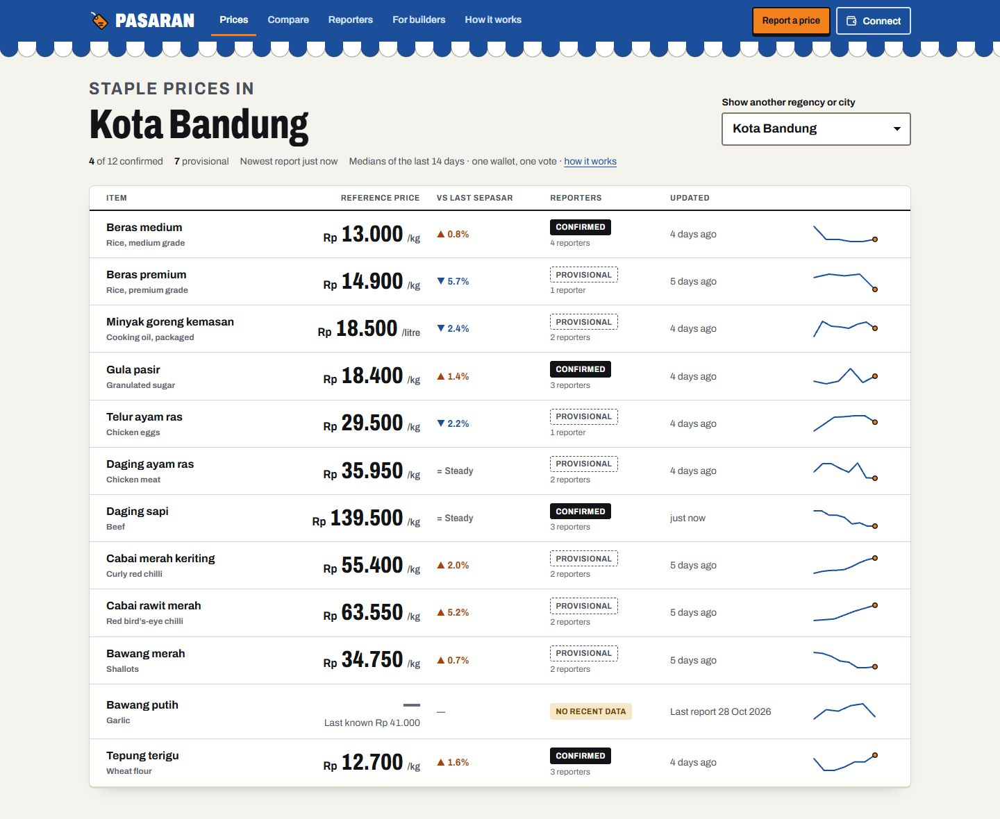

## Screenshots

Taken from the local chain with the sample data that `npm run seed:local` creates. None of these prices are real.

### Reading prices

| Price detail | Compare across places |
|---|---|
| 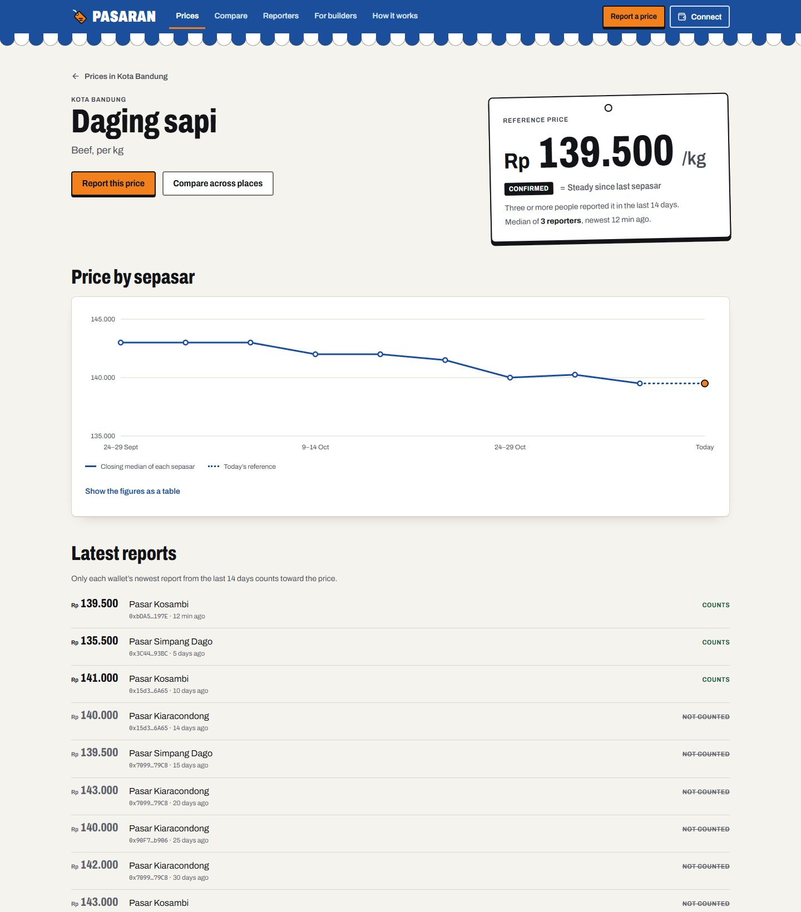 | 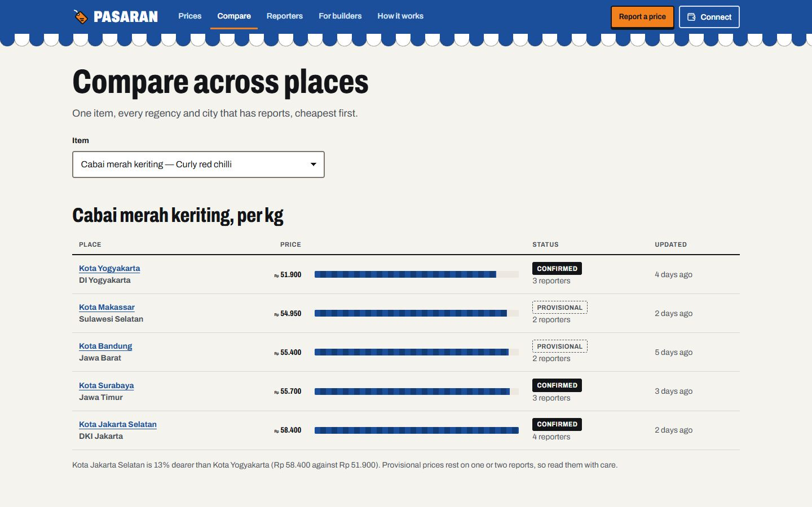 |

### Reporting a price

| A price far from the reference asks first | Reported |
|---|---|
|  | 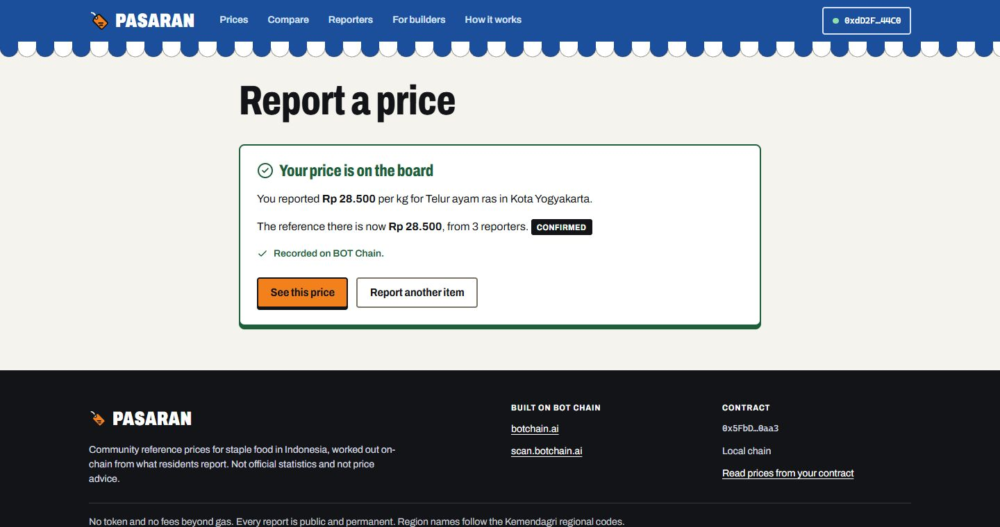 |

| My reports | For builders |
|---|---|
| 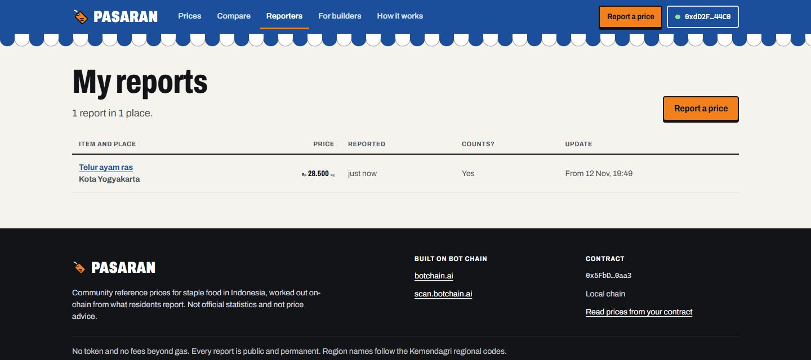 | 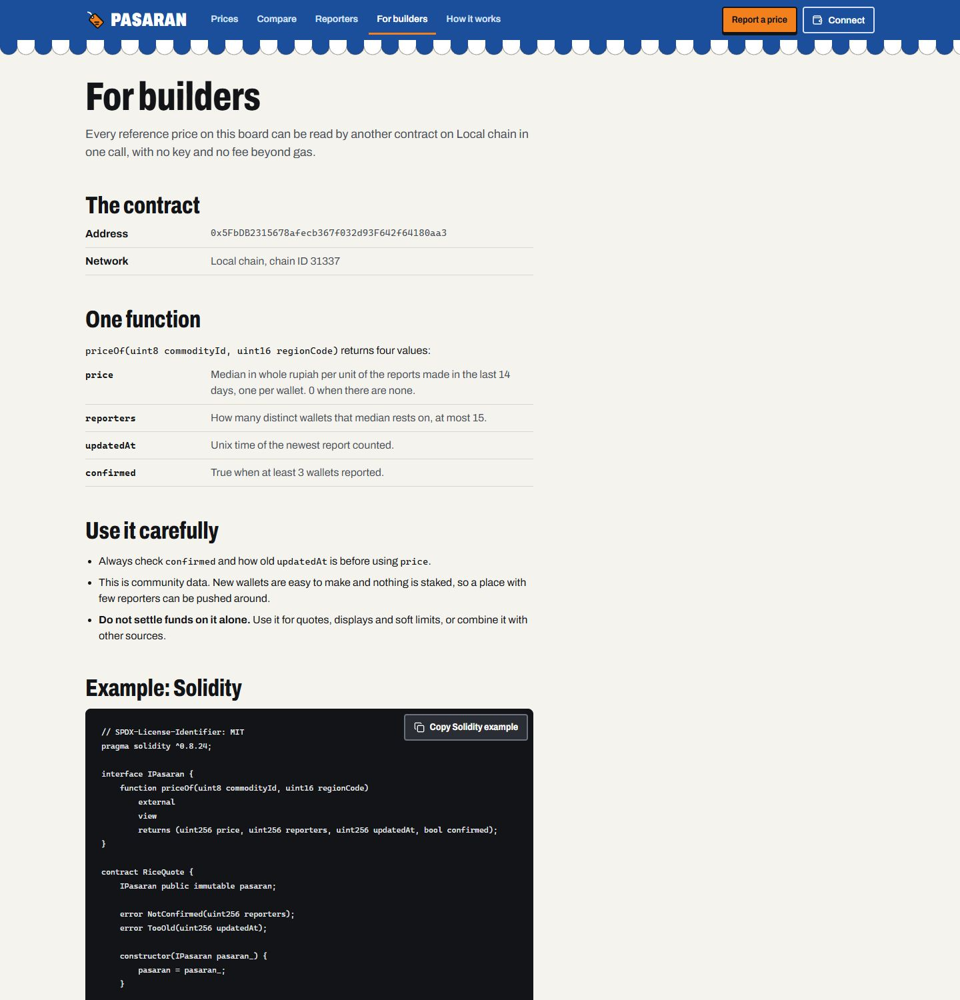 |

### How it works

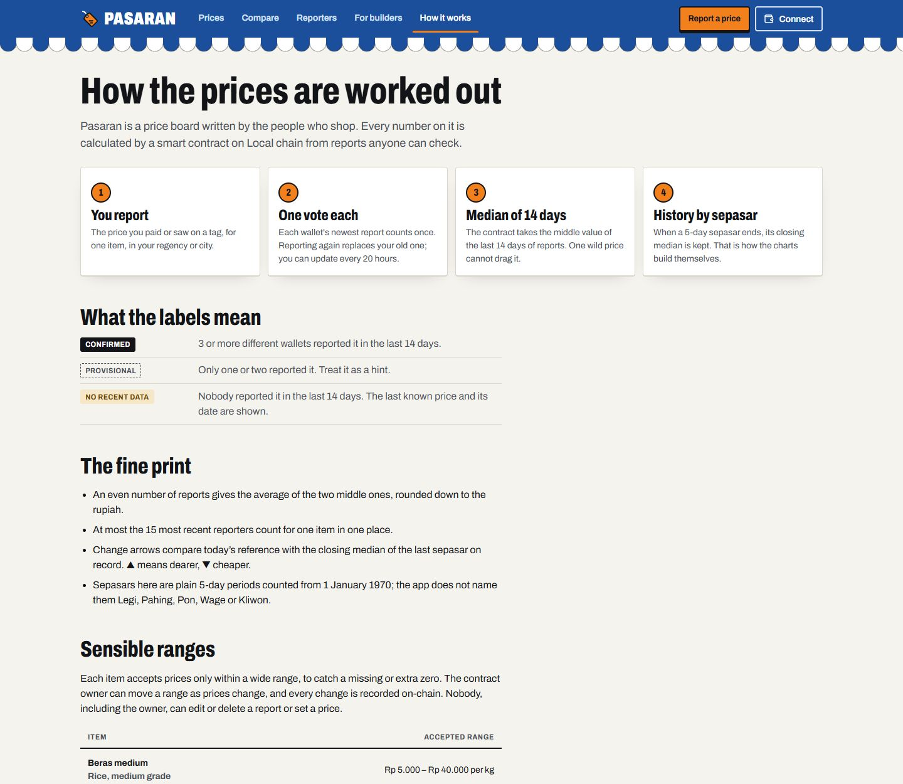

### Phone and tablet

| Board at 375 px | Price detail at 375 px | Report form at 375 px |
|---|---|---|
| 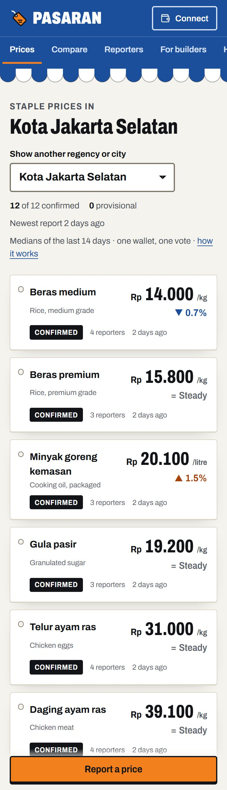 | 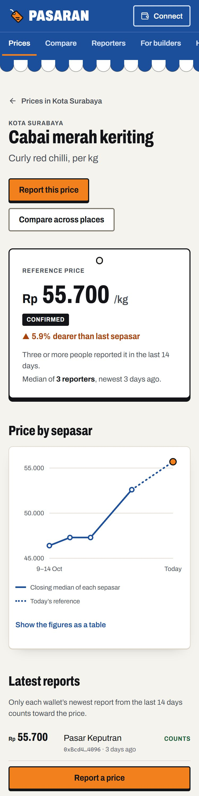 | 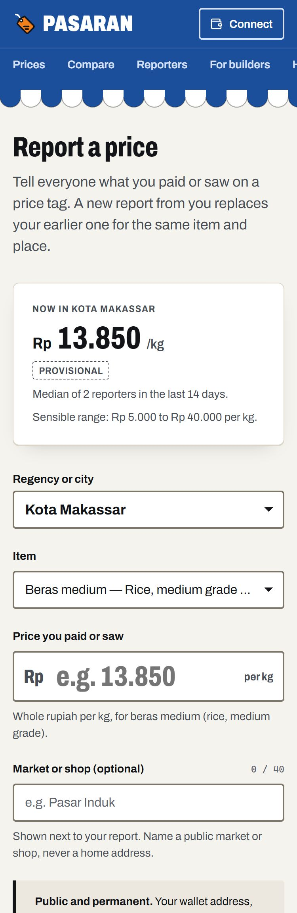 |

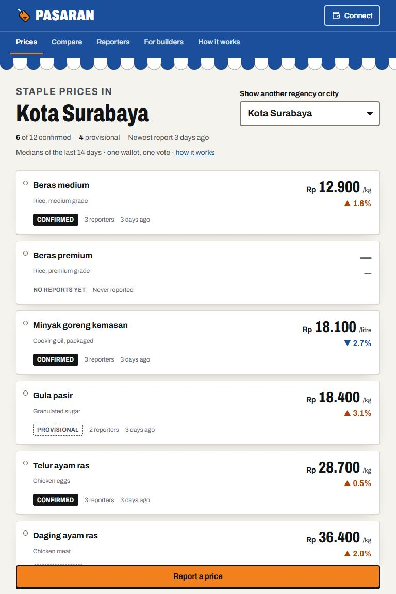

## Layout

```
pasaran/
├── contracts/   Hardhat project: Pasaran.sol, examples/PriceReader.sol, tests, deploy/seed scripts
├── web/         Vite + React + TypeScript + viem front end
└── docs/        Screenshots used in this README
```

## Run it locally

Requires Node 22. The local chain runs on port **8549** and the web app on **5177**, so they do not clash with the other projects in this folder.

```bash
# 1. A local chain (leave it running). Its clock starts 45 days in the past.
cd contracts
npm install
npm run node
```

```bash
# 2. In a second terminal: deploy with the starting catalogue, then add sample reports
cd contracts
npm run deploy:local
npm run seed:local
```

```bash
# 3. In a third terminal: the web app, at http://localhost:5177
cd web
npm install
npm run dev
```

The seed script lays down nine sepasars of sample reports across six cities and finishes at the real time of day, so the charts have history. It refuses to run on any public network.

On the local chain the wallet dialog lists four "Dev wallet" accounts. They ask the Hardhat node to sign, so you can report from several wallets and watch a price become confirmed without a browser extension. They exist only in the dev server; production builds do not contain them.

The local chain keeps nothing between runs: after stopping the node, deploy and seed again.

## Checks

```bash
cd contracts && npm test          # 31 contract tests, including a random-data median check
cd web && npm run typecheck       # TypeScript
cd web && npm run build           # production build into web/dist
```

## Which network the web app uses

| `VITE_CHAIN` | Network | Used by default in |
|---|---|---|
| `local` | Hardhat node, chain 31337, port 8549 | `npm run dev` |
| `testnet` | BOT Chain Testnet, chain 968 | — |
| `mainnet` | BOT Chain Mainnet, chain 677 | `npm run build` |

Contract addresses live in `web/src/config/deployments.json`. The deploy script fills in the right entry. Until an address is present for the active network, the site shows a "not deployed yet" notice instead of prices.

## Deploy the contract

The deployer key stays on your machine.

```bash
cd contracts
cp .env.example .env      # then put the deployer key in .env as PRIVATE_KEY=0x...
npm run deploy:testnet    # BOT Chain Testnet (968) — test BOT from https://faucet.botchain.ai/basic
npm run deploy:mainnet    # BOT Chain Mainnet (677)
```

The deploy script also adds the 12-item starting catalogue from `contracts/scripts/catalog.js` (13 transactions in all, about 0.086 BOT at 20 gwei). Each deploy writes `contracts/deployments/<network>.json` and updates `web/src/config/deployments.json`; commit both so the site picks up the address.

Before mainnet:

- Create the project's group first: the program does not count projects that were on mainnet earlier.
- Review the sensible price ranges in `contracts/scripts/catalog.js`. They are wide estimates (roughly a third to three times a normal price) meant to catch a missing or extra zero.
- Never run `seed:local` against a public network; it refuses to, and invented prices must not reach mainnet.

## Host the web app on Vercel

| Setting | Value |
|---|---|
| Root Directory | `web` |
| Framework Preset | Vite |
| Build Command | `npm run build` |
| Output Directory | `dist` |

No environment variables are needed for mainnet. Routes are hash-based (`#/price/0/3273`), so no rewrites are required.

## Regions

Places are Indonesian regencies and cities, identified by four-digit Kemendagri codes (province + regency/city; cities start at 71). The contract accepts any well-formed code. The web app names 60 large cities and regencies from a hand-written list in `web/src/data/regions.ts`; that list should be checked against, or replaced by, the full official list before mainnet.

## What the contract costs to use

Measured in the test suite, at 20 gwei:

| Action | Gas | BOT |
|---|---|---|
| Deploy | 3,061,977 | 0.061 |
| Starting catalogue (12 items) | 1,248,540 | 0.025 |
| First report for an item in a place | 440,813 | 0.0088 |
| A new reporter on an existing item and place | 288,130 | 0.0058 |
| Full board of 15, also closing a sepasar | 377,510 | 0.0076 |
| A returning reporter updating their vote | 201,065 | 0.0040 |

Contract bytecode: 13,814 bytes of the 24,576 limit. The contract holds no funds and has no payable function.

## Reading prices from another contract

See `contracts/contracts/examples/PriceReader.sol` and the "For builders" page in the app. Always check `confirmed` and `updatedAt` before using `price`, and do not settle funds on community data alone.
